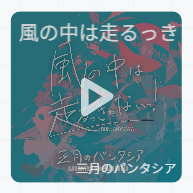
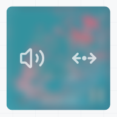

# BBlock

[ Lang: [简体中文](./README.md) | English ]  

🎵 Wow~ you can really play! Square Music Player.

> A lightweight, simple music player—perfect for blogs and personal pages.

* [jsDelivr](https://www.jsdelivr.com/package/npm/bblock)  
<!-- * [npmmirror](https://registry.npmmirror.com/bblock/latest/files)   -->
* [npm](https://www.npmjs.com/package/bblock)  

## Demo

  

[bblock.js.org/demo](https://bblock.js.org/demo)  

## 1. Let's Use It!

<details>

<summary>Expand for <code>v1.x.x</code> setup instructions</summary>

1. Include `bblock.(m.).css` in the page head, and include `bblock.(m.).js` after all `<bblock></bblock>` tags.
2. Add a tag like this to your HTML:
   ```html
   <bblock style='display:none'>
		{
			"src":"<musicurl>",
			"cover":"<musiccover>",
			"title":"S.T.A.Y. (Delta Heavy Tribute)",
			"artist":"Delta Heavy / Hans Zimmer",
			"volume":20,
			"time":0,
			"loop":"false",
			"float":"right"
		}
   </bblock>
   ```

   |Key|Value|Notes|
   |-----|-----|-----|
   |src|Music URL|Required|
   |cover|Cover image URL|Optional|
   |title|Track title|Optional|
   |artist|Track artist|Optional|
   |volume|Volume|Optional. Range: [0,100]. Default: 100|
   |time|Initial playback position|Optional. In seconds|
   |loop|Whether to loop playback|Optional. Disabled by default|
   |float|The CSS `float` property|Optional|

3. Initialize players manually:

   Loading `bblock.(m.).js` automatically initializes all players wrapped in `<bblock></bblock>` tags on the page. For special cases, such as AJAX-based pages, run the following code to initialize these players:

   ```javascript
   bblock.s();
   ```

---

</details>

BBlock `v2.x.x` introduces a new API for creating player instances while **maintaining backward compatibility with the `v1.x.x` `bblock.s()` method**:  

```javascript
const player = new BBlockPlayer(element, config);
// Or
const player = bblock.c(element, config);
```

Here, `element` is an HTML element object, and `config` is a configuration object supporting the following fields:

|Key|Value|Notes|
|-----|-----|-----|
|`src`|Music URL|**Required**|
|`cover`|Cover image URL|Optional|
|`title`|Track title|Optional|
|`artist`|Track artist|Optional|
|`volume`|Volume|Optional. Range: 0–1. Default: 1|
|`time`|Initial playback position|Optional. In seconds. Default: 0|
|`loop`|Whether to loop playback|Optional. Accepts the boolean values `true` / `false`. Disabled by default|
|`float`|The CSS `float` property, controlling player placement|Optional. Default: `none`|
|`language`|Interface language|Optional. Accepts `zh-CN`, `zh-TW`, or `en-US`. Default: `zh-CN`|
|`progressColor`|Progress bar color|Optional. A CSS color value or `none`. Default: `none` (background-adaptive color)|
|`progressOpacity`|Progress bar opacity|Optional. Range: 0–1. Default: 0.6|

### 1.1. Quick Start: Browser Usage

```html
<div id="my-player"></div>
<script src="https://cdn.jsdelivr.net/npm/bblock@latest/dist/bblock.umd.js"></script>
```

```javascript
const containerEl = document.getElementById('my-player');
const player = new BBlockPlayer(
   containerEl,
   {
      "src":"https://music.163.com/song/media/outer/url?id=3428531701",
      "cover":"https://p1.music.126.net/R6Gm6V1C_abBY3f_XbKIug==/109951173855089233.jpg",
      "title":"ED 记忆管理局2026",
      "artist":"StJimmyL / Ray1-睿壹 / 小欣Xier",
      "loop":"true",
      "float":"right"
   }
)
```

### 1.2. Using Module Imports

```bash
# Install the bblock package
npm install bblock
```

```javascript
// import bblock, { BBlockPlayer } from 'bblock.esm.js';
import bblock, { BBlockPlayer } from 'bblock';

const element = document.getElementById('my-player');
const config = {
   src: 'https://music.163.com/song/media/outer/url?id=3428531701',
   title: 'ED 记忆管理局2026',
   artist: 'StJimmyL / Ray1-睿壹 / 小欣Xier'
};

const player = new BBlockPlayer(element, config);
// You can also create an instance with bblock.c(element, config)
```

## 2. Playback Controls and Volume Controls

Despite being tiny, it still has playback controls and volume controls. (;ﾟ∀ﾟ)

For older versions (<= `v1.4.1`):

* Hover over the player to reveal two equal-sized blocks, one blue and one purple.
* Drag the blue block on the left to adjust the playback position.
* Drag the purple block on the right to adjust the volume.
* Click either block to see the current playback position or volume, respectively.

For `v2.x.x`:

* After playback starts, hover over the square to reveal the controls:

   

* Drag the volume icon on the left to enter volume adjustment mode, or drag the icon on the right to enter playback position adjustment mode.
* The controls hide immediately when the pointer leaves the player. They also hide automatically after a few seconds if the pointer stays still over the player.  

## 3. Player API

In `v2.x.x`, each `BBlockPlayer` instance provides methods and properties, including writable properties. The descriptions below use the `player` instance created in the example above.

<details>

<summary>Expand to view</summary>

### 3.1. Methods

|Method|Description|
|-----|-----|
|`player.play()`|Start playback|
|`player.pause()`|Pause playback|
|`player.seek(time)`|Seek to the specified position, in seconds|
|`player.reload(deltaConfig = {})`|Rebuild the player, overriding the original configuration with the supplied fields. For example, `{loop: true, float: "left"}` sets `loop` to `true` and `float` to `left` **while retaining other settings**. Reloading keeps the player ID, but resets playback state and removes all existing event listeners. The underlying `audioElement` also changes, so retrieve it again if you need to use it|
|`player.destroy()`|Destroy the player, remove event listeners, and restore the container's original HTML and inline styles|
|`player.on(eventName, callback)`|Register an event listener; see below for details|
|`player.off(eventName, callback)`|Remove a callback for the specified event. Pass the same function reference used when registering it|
|`player.offAll()`|Remove all event listeners registered through `player.on()`|

### 3.2. Properties

|Property|Access|Description|
|-----|-----|-----|
|`player.volume`|Read/write|Volume, ranging from 0 to 1|
|`player.loop`|Read/write|Whether to loop playback. Accepts the boolean values `true` / `false`|
|`player.progressColor`|Read/write|Progress bar color. Accepts a CSS color string or `none` (background-adaptive color)|
|`player.progressOpacity`|Read/write|Progress bar opacity, ranging from 0 to 1|
|`player.currentTime`|Read-only|Current playback position, in seconds. Use `seek()` to change the playback position|
|`player.audioElement`|Read-only|The underlying `HTMLAudioElement`, which you can use to read native properties such as `duration` and `paused`|
|`player.id`|Read-only|The player's unique ID, as a string|
|`player.destroyed`|Read-only|Whether the player has been destroyed|

### 3.3. Global Instance Management

The global `bblock` object is retained for compatibility with `v1.x.x`.

|API|Description|
|-----|-----|
|`bblock.c(element, config)`|Create and return a `BBlockPlayer` instance|
|`bblock.s()`|Scan the page for `<bblock>` tags and initialize players using their JSON configurations. Returns an array of instances created during this scan. The script automatically scans once each time it runs|
|`bblock.get(id)`|Get the current player instance by ID. Returns `null` if it does not exist|
|`bblock.currentPlayers`|Get all **existing** players on the current page as an array of `[id, player]` pairs|

**Note**: Removing a player element from the current DOM automatically destroys the player (`destroy()`).

</details>

## 4. Event Binding

Use `player.on(eventName, callback)` to bind player events. You can register multiple callbacks for the same event, but registering the same function reference multiple times will overwrite the previous registration. Event names are lowercase.

<details>

<summary>Expand to view supported events</summary>

### 4.1. Native Audio Events

Native audio events such as `play`, `canplay`, and `timeupdate` are bound directly to the underlying `<audio>` element when registered via `player.on`. Unlike event listeners added using `addEventListener` on `player.audioElement`, listeners registered via `player.on` are automatically managed and, by default, share the same lifecycle as the player.  

### 4.2. Player Events

The player also emits some events of its own ( *ˊᵕˋ)σ

|Event name|Callback arguments|When it fires|
|-----|-----|-----|
|`controlsshow`|None|When the controls appear|
|`controlshide`|None|When visible controls hide|
|`volumecontrolstart`|None|When volume adjustment mode starts <br> (Unlike the `<audio>` element's `volumechange` event, this fires once when the user presses the volume icon to enter adjustment mode, rather than continuously while dragging)|
|`volumecontrolend`|None|When volume adjustment ends (when returning from the volume adjustment view to the default controls view)|
|`progresscontrolstart`|None|When playback position adjustment mode starts (as above, this differs from the `<audio>` element's `timeupdate` event)|
|`progresscontrolend`|None|When playback position adjustment ends|
|`tipshow`|`(message, duration)`|When a tip starts appearing. The callback receives the tip text and display duration in milliseconds|
|`tiphide`|`(message, duration)`|When a tip starts hiding. The callback arguments are the same as for `tipshow`|
|`destroy`|None|Before the player is destroyed. Also fires when `reload()` is called|

</details>

## 5. Build It

```bash
npm install
npm run build
```

Build artifacts are written to the `./dist` directory:

```text
dist/
├── bblock.classes.json
├── bblock.esm.js
└── bblock.umd.js
```

## 6. Thanks

* @[小太](https://github.com/CatSouta)
* @[奇趣保罗](https://github.com/Dreamer-Paul)

## Third-Party Projects and Licenses

This project uses some icons from [Lucide Icons](https://lucide.dev/), licensed under the [ISC License](./LICENSES/lucide.txt). Thanks to the open-source icon contributors! (´ｰ∀ｰ`)

## LICENSE

Licensed under the MIT License.

Thanks for using. (￣▽￣)"
